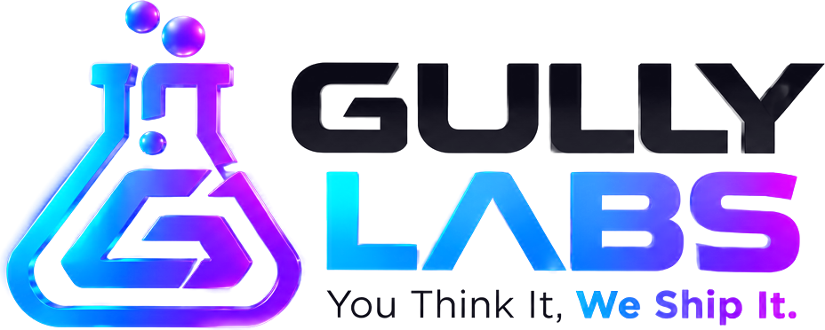

<!-- gully-header:start -->

  <a href="https://gullylabs.xyz">
    <picture>
      <source media="(prefers-color-scheme: dark)" srcset=".github/assets/gully-labs-logo.png">
      
    </picture>
  </a>

<b>You Think It, We Ship It.</b>

The Gully Labs organisation profile: every Gully product in one place.

  
  
  
  

Built and run by <a href="https://gullylabs.xyz">Gully Labs</a>. You Think It, We Ship It.

---
<!-- gully-header:end -->

# gully-labs/.github

The Gully Labs organisation profile. The page shown on [github.com/gully-labs](https://github.com/gully-labs) is [`profile/README.md`](profile/README.md); its images are in `profile/assets/`.

<!-- gully-footer:start -->
---

  <a href="https://gullylabs.xyz">
    <picture>
      <source media="(prefers-color-scheme: dark)" srcset=".github/assets/powered-by-gully-labs-dark-2x.png">
      
    </picture>
  </a>

<!-- gully-footer:end -->
